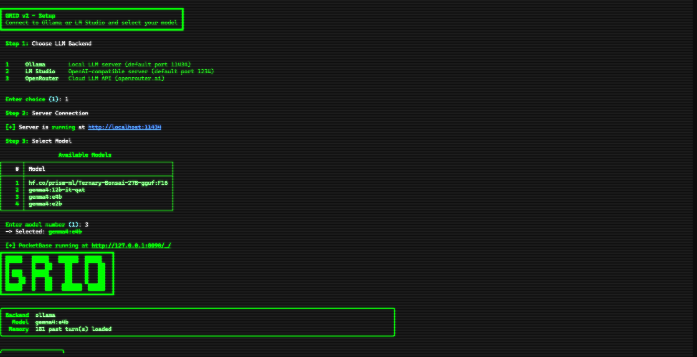
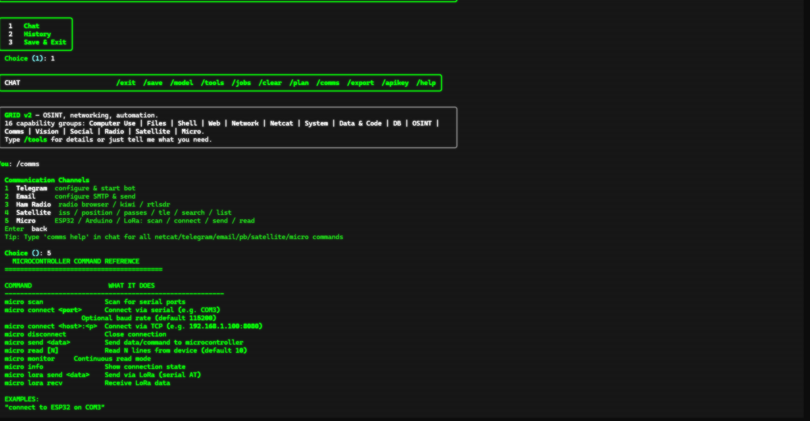
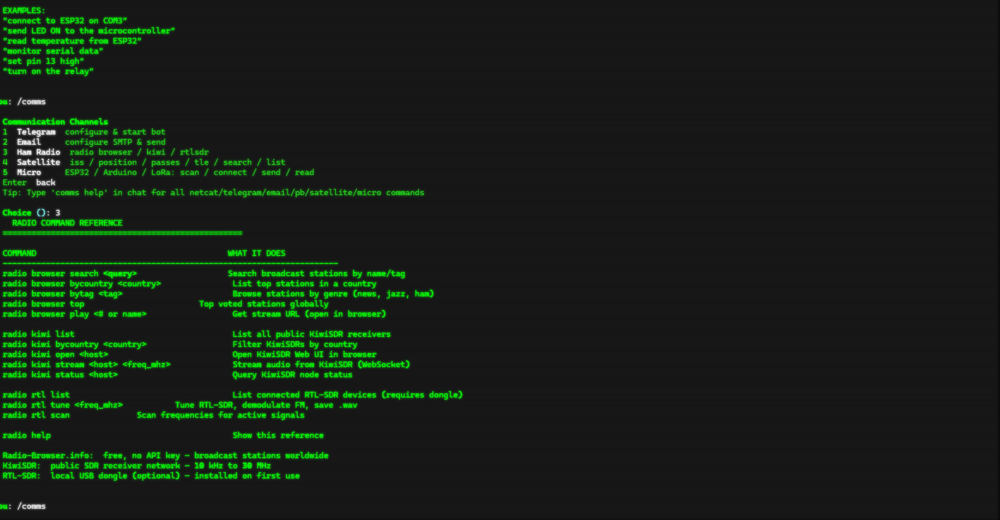
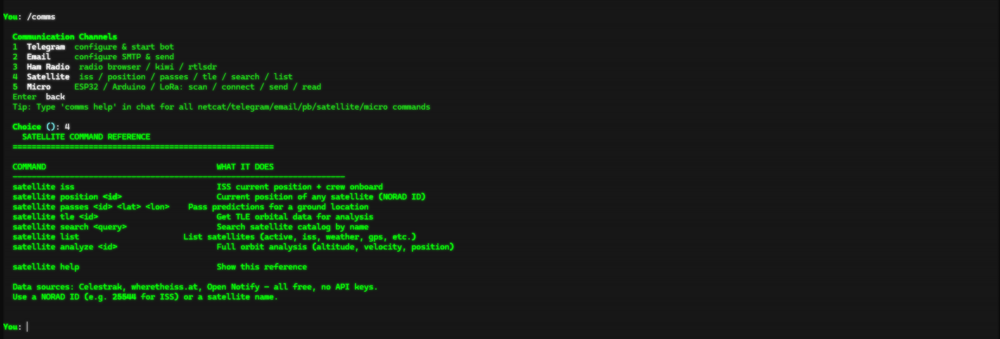

<div align="center">

# GRID v3

### General Reconnaissance & Intelligence Dashboard

*Local-first AI agent with a native Compose Desktop app, Android companion, and an 82-tool reconnaissance stack.*

[](https://www.python.org/) [](README.md) [](clients/) [](docs/ADR-0002-kmp-agent-ui.md) [](README.md) [](GRID_Tools_Test_Guide.docx)

</div>

> 📘 **New to GRID?** Download the **[GRID Tools Test Guide](GRID_Tools_Test_Guide.docx)** — the full manual with command reference, tool descriptions, and examples.

---

## ✨ What is GRID?

GRID is a self-aware agent that runs locally and can operate from three surfaces:

- **Terminal host** — `python grid_agent.py`
- **Compose Desktop** — native chat, approvals, provider setup and thread replay
- **Android companion** — the same host over your LAN

It combines **16 capability groups** — OSINT, network recon, authorized REA, SDR/radio, satellite tracking, microcontroller IoT, computer vision, agent platforms, automation and more — under one conversational interface. Use a local **Ollama** model, **LM Studio**, **OpenRouter**, or **OpenAI**; switching providers does not restart the host.

Memory is layered and local: a durable user profile, DuckDB atoms/scenarios, raw transcript, and offloaded tool refs. The desktop adds persisted threads, native tool surfaces, token/time meters, copy buttons, a stop control, and slash-command + subcommand autocomplete.

### New in this build

- **Desktop + Android clients** over AG-UI 1.0 (HTTP + SSE), with a shared Kotlin client.
- **First-run setup**: choose provider, load models, write `config.json`, and start the local host from the desktop.
- **Provider switching** in the sidebar: Ollama, LM Studio, OpenRouter, OpenAI.
- **Thread history and replay**, including persisted tool cards; click a thread while a run is streaming to stop and reload it.
- **Server-driven UI** (`grid_ui.py`): tool results and REA findings render as native cards, tables, key/value grids, charts and artifacts with a plain-text fallback.
- **Slash subcommands** for `/social`, `/ctf`, `/rea`, `/satellite`, `/radio`, `/micro`, `/osint`, `/gcal`, `/gsheet`, `/jobs`, `/life`, `/memory`, `/persona` and `/pb`.
- **PocketBase** is now available from `--api` mode as an optional mirror; **DuckDB** remains the primary memory/analytics store.

---

## 🖥️ Desktop & Android at a glance

```text
┌──────────────────────────────┐        HTTP + SSE         ┌──────────────────────────────┐
│ Compose Desktop / Android    │ ────────────────────────▶ │ Python host (--api)          │
│ - chat, threads, approvals   │                           │ - GridAPIServer              │
│ - provider setup             │ ◀──────────────────────── │ - orchestrator + tools       │
│ - native server-driven UI    │        AG-UI events       │ - DuckDB + thread store      │
└──────────────────────────────┘                           └──────────────┬───────────────┘
                                                                          │
                                                          Ollama / LM Studio / OpenRouter / OpenAI
```

The desktop is not a mock UI: it launches the real Python host, streams real tool events, and can stop the host with `/shutdown`. The Android app uses the same API and token.

---

## 🧠 The New: Layered Memory Engine

The latest release adds a real memory system that works across sessions with **zero new dependencies** (DuckDB keyword recall, fully local).

| Layer | What it holds | Where it lives |
|---|---|---|
| **L3 · User profile** | Durable facts & preferences about you | `grid_persona.md` |
| **L2 · Scenarios** | Summaries of completed tasks | DuckDB `memory_scenarios` |
| **L1 · Atoms** | Standalone factual statements | DuckDB `memory_atoms` |
| **L0 · Transcript** | Raw conversation | `memory.md` |
| **Refs** | Full verbatim tool outputs (offloaded) | `refs/<id>.md` |

**How it works:**
- **User profile first**: `grid_persona.md` is injected into every turn as the `USER PROFILE` block, before technical memory. The model is told to use it and not ask you to repeat yourself.
- **Every 5 turns**, GRID silently runs one LLM distillation pass over recent history via `Recaller.distill()` — extracting atomic facts, task scenarios, and durable **user** facts. System specs, IPs and tool output are excluded from the profile.
- **Remember lines**: when the model spots a durable fact about you, it can append `REMEMBER: <fact>`. The harness stores it and hides the line from the reply.
- **On every turn**, `_build_messages()` injects the profile plus *only the memories relevant to the current request* (keyword recall) alongside your recent turns — so context stays lean and relevant, not bloated.
- **Tool-output offload**: verbose tool results (>800 chars) are written whole to `refs/`; the model is handed a short preview + a reference id it can pull the full output from on demand — dramatically cutting token usage on long chains.

**Memory commands & tools:**

| Command / Tool | Purpose |
|---|---|
| `/memory` | Show memory stats (atoms / scenarios / refs / profile) |
| `/memory <query>` | Recall memories relevant to a query |
| `/memory add <fact>` | Save a durable fact about you to the profile |
| `/memory profile` | Show the full user profile |
| `/memory forget <fact>` | Remove matching profile facts |
| `/memory build-profile` | Mine previous chats for durable user facts |
| `/memory clear` | Reset the technical memory store (profile untouched) |
| `/memory clear-profile` | Clear the user profile |
| `remember that ...` | Chat shortcut for `/memory add` |
| `forget that ...` | Chat shortcut for `/memory forget` |
| `/ref <id>` | Read a full offloaded tool output |
| `memory_recall` | Tool — search layered memory for context |
| `memory_status` | Tool — memory layer health |
| `ref_read` | Tool — pull an offloaded ref by id |

The profile refuses credentials, API keys, passwords and secrets. You can also edit `grid_persona.md` directly; it is read again on the next turn.

### DuckDB vs PocketBase

They are separate layers, not alternatives.

| | **DuckDB** | **PocketBase** |
|---|---|---|
| What it is | Embedded analytical database | Optional external REST service |
| Runs as | In-process library | `pocketbase.exe` on `127.0.0.1:8090` |
| File/location | `grid_data.duckdb` | `pb_data/` + admin UI |
| Required? | Core memory/analytics when installed | Optional mirror/admin surface |
| Tables/collections | `tool_logs`, `web_cache`, `scan_results`, `sessions`, `memory_atoms`, `memory_scenarios`, `memory_refs` | `conversations`, `artifacts`, `settings` |
| Used by | `Recaller`, `/memory`, `/ref`, `db_query`, `db_analytics`, tool logging | `/pb`, `pb_status`, `pb_sync`, `pb_upload` |
| Network | None | Loopback REST |
| Primary data? | **Yes** for layered memory, logs and refs | **No** — a sync/backup/inspection mirror |

DuckDB is the primary local store. The profile lives in `grid_persona.md`, the transcript in `memory.md`, offloaded tool outputs in `refs/`, and atoms/scenarios/refs in DuckDB. PocketBase mirrors recent conversations, artifacts and settings for its admin UI and optional external use.

PocketBase does **not** need the Python `pocketbase` package. `grid_pb.py` talks to the PocketBase binary over HTTP using `requests`; the binary is downloaded with `/pb install` and started with `/pb start`. In `--api` mode the manager is now initialized lazily, so `/pb status`, `/pb start`, `/pb stop`, `/pb install` and `/pb sync` work from the desktop. The default admin credentials are `admin@example.com` / `change-me-password`; change them before exposing the service.

*Inspired by the layered-memory approach popularised by agent frameworks such as Hermes and OpenClaw and TencentDB Agent Memory — humanlike memory, not a bigger scratchpad.*

---

## 🥊 GRID vs Hermes vs OpenClaw — where each fits

Last checked: **November 2026**. Hermes Agent is at [v0.23.4](https://github.com/NousResearch/hermes-agent/releases/tag/v0.23.4) (Nov 23) and OpenClaw at [v2026.11.10](https://github.com/openclaw/openclaw/releases/tag/v2026.11.10) (Nov 25). Both are broader than the old “coding vs messaging” split, so this table compares what each is actually built for.

| Capability | **GRID v3** | **Hermes Agent v0.23.4** | **OpenClaw v2026.11.10** |
|---|---|---|---|
| **Primary focus** | Recon / field ops + local desktop/Android host | Self-improving generalist, coding and knowledge work | Messaging-first personal assistant and Gateway |
| **Memory** | Profile + DuckDB atoms/scenarios/refs + transcript + offloaded refs | Agent-curated memory, FTS5 session search, Honcho user modeling, SQLite | **Knowledge** memory plugin + session/Gateway memory + compaction |
| **OSINT** | Built-in domain/IP/email/phone/username, dorking, webcam/CCTV | Browser, web search, MCP/plugins; no dedicated recon suite | Deep Research with cited sources + browser; no dedicated recon suite |
| **Network recon** | Built-in Nmap, DNS, netstat, TCP/UDP netcat suite | Generic shell/MCP + local/Docker/SSH/cloud terminal backends | Generic tools; no built-in recon suite |
| **SDR / HAM radio** | Built-in Radio-Browser, KiwiSDR, RTL-SDR | Plugin/terminal only | Plugin/node only |
| **Satellite tracking** | Built-in ISS, passes, TLE, catalog | Plugin/terminal only | Plugin/terminal only |
| **Microcontroller IoT** | Built-in ESP32/Arduino/LoRa serial + TCP | Plugin/MCP only | Nodes/plugins only |
| **Computer vision** | Built-in OCR, faces, camera validation, video forensics | Browser/computer-use MCP | Camera/screen nodes |
| **Computer use** | Mouse, keyboard, screen, typing | Yes — Desktop, terminal backends, browser | Yes — native apps, nodes, browser |
| **Self-authoring skills** | Yes | **Strongest** — auto-created/self-improving skills, 50 bundled + 150+ optional | Skills, plugins and ClawHub catalog |
| **SQL / analytics** | DuckDB + optional PocketBase mirror | SQLite + FTS5 | SQLite Gateway/session store |
| **Messaging** | Telegram, email, Moltbook social agent | Telegram, Discord, Slack, WhatsApp, Signal, Email | **20+ channels** — WhatsApp, Telegram, Slack, Discord, iMessage, Teams, … |
| **LLM providers** | Ollama, LM Studio, OpenRouter, OpenAI | 300+ via Nous Portal/OpenRouter/OpenAI/local endpoints | Many providers, local Ollama/LM Studio, Claude/Codex harnesses |
| **Clients** | Terminal + native Compose Desktop + Android + AG-UI API | desktop, CLI/TUI, web, messaging gateway | Native macOS/iOS/Android/Windows/Linux apps + Control UI + 20+ channels |
| **Deployment** | Python host + Compose clients, local-first | Python/Node gateway, Docker, cloud sandboxes | Node Gateway + native apps, Docker, multiplayer |
| **Enterprise** | Local-first, bring your own host | **Microsoft Foundry/Teams/Microsoft Store/Azure sandboxes**, Hermes Enterprise | OpenClaw Foundation, security presets, multiplayer claws |
| **REA / passive teardown** | **Built-in authorized passive teardown** with reports and artifacts | Not a built-in workflow | Not a built-in workflow |

### The honest pitch

- **Hermes** is the strongest **self-improving generalist**. In November it shipped a single gateway for every surface, durable subagents, sub-second Azure sandboxes, Microsoft Teams/Store integration, 300+ models, and a deep skills/plugin ecosystem. If you want an agent that learns procedures and works across coding, knowledge work and messaging, Hermes is the reference.
- **OpenClaw** is the strongest **messaging-first personal assistant**. In November it shipped **Knowledge** memory, cited Deep Research, browser handoff, agent templates, OpenClaw ID, multiplayer sessions, native apps on every major OS, and 20+ channels. If your assistant should live in chat apps and shared team spaces, OpenClaw is hard to beat.
- **GRID** is the **field-ops / recon specialist**. It is the one with a purpose-built **OSINT + network + REA + SDR + satellite + microcontroller + vision** stack, a local DuckDB memory model, a native Compose Desktop + Android client, and an AG-UI API your own tools can talk to. It is not trying to out-skill Hermes or out-message OpenClaw; it is trying to give you hands in the field.

**Bottom line:** Hermes grows with you. OpenClaw lives in your chats. **GRID recons the world.** If your work touches networks, airwaves, orbit, or physical devices — and you want it local-first with a native desktop/Android UI — GRID is the one to reach for.

---

## Requirements

- **Python 3.10+**
- **Ollama** (local LLM) — https://ollama.ai — or LM Studio / OpenRouter / OpenAI
- **Java 21** for the Compose Desktop and Android builds
- **Android SDK** if building the Android companion
- **Tesseract OCR** *(optional)* — for image text extraction:
  - `winget install UB-Mannheim.TesseractOCR`
  - or https://github.com/UB-Mannheim/tesseract/wiki

## Quick Start

```bash
# Step 1: Install all dependencies
python install.py

# Step 2: Launch GRID
python grid_agent.py
```

On first launch, select your LLM backend (Ollama), then pick a model.

### Desktop app

The desktop can start the Python host itself. From a fresh clone:

```powershell
cd clients
.\gradlew.bat :desktopApp:run
```

Click **Start GRID host**, choose a provider, load models, and connect. If you prefer to run the host separately:

```powershell
# terminal 1
python grid_agent.py --api --no-input

# terminal 2
cd clients
.\gradlew.bat :desktopApp:run
```

### Android companion

```powershell
cd clients
.\gradlew.bat :androidApp:assembleDebug
adb install -r androidApp\build\outputs\apk\debug\androidApp-debug.apk
```

On first launch, enter the host URL and the contents of `run/api_token`. See [Kotlin clients](#kotlin-clients-desktop--android) for LAN setup.

### Clean start (recommended)

Use an isolated environment, check the setup, then launch without the wizard.

```powershell
# 1. Install Ollama, then pull the model
ollama serve
ollama pull gemma4:e2b

# 2. Create an isolated environment
python -m venv .venv
.\.venv\Scripts\python.exe -m pip install --upgrade pip
.\.venv\Scripts\pip.exe install -r requirements.txt

# 3. Create config from the example
Copy-Item config.example.json config.json
# edit config.json if your Ollama model name differs

# 4. Check the setup before launching
.\.venv\Scripts\python.exe grid_agent.py --check

# 5. Launch without the setup prompts
.\.venv\Scripts\python.exe grid_agent.py --no-input
```

`--check` verifies Python, the required imports, `config.json`, the Ollama server, the selected model and the 82-tool registry. It does not start PocketBase or touch `grid_data.duckdb`.

Useful flags:

- `--no-banner` — skip the 5-second Matrix banner.
- `--install-missing` — install optional packages (RTL-SDR, MiniGrid, UPnP, etc.). Without it, missing optional tools are reported and disabled.
- `--no-input` — use `config.json` instead of the backend/model wizard.

If `--check` fails, fix the FAIL lines it prints. Do not launch until all required checks pass.

If the model says it has no tools, make sure Ollama is running and the model supports at least a 16k context. GRID sets `num_ctx=16384`; a smaller context truncates the 82-tool schema.

### Chat input

**Terminal:** type `/` and press **Tab** to complete a slash command. Subcommands complete too (`/persona ` shows `set` and `clear`). **Up/Down** walks prompt history, and matching history appears as grey inline text.

**Desktop:** type `/` for the command palette. Type a space after a command with documented subcommands (`/social `, `/ctf `, `/rea `, `/satellite `, `/radio `, `/micro `, `/osint `, `/gcal `, `/gsheet `, `/jobs `, `/life `, `/memory `, `/persona `, `/pb `) to open the second-level palette. Arrow keys select, Tab completes, Enter executes no-arg subcommands immediately, and Esc closes the palette. `/help`, `/new`, `/clear`, `/exit`, `/provider`, `/model`, `/tokens`, `/rea`, `/tools`, `/tool` are local; the rest route through the host.

### Desktop quick tour

- **Sidebar** — host status, thread, endpoint, provider, model, token meter, history, quick prompts.
- **Change provider** — provider, base URL, API key, model dropdown, Refresh.
- **Change model** — switch models without restarting the host.
- **HISTORY** — persisted threads; click to replay, **Refresh** to reload, **Clear** to delete threads only.
- **Composer** — `/` commands, subcommands, Enter to send, Stop while streaming.
- **Tool cards** — native server-driven UI surfaces (tables, key/value grids, findings, artifacts) with copy buttons.
- **Activity row** — `Thinking…` with elapsed time, then `+commands · edits · thoughts · reads · tools`.

### GRID Life

GRID v3 adds a persistent local life layer: identity, goals, commitments, a heartbeat, an iLog, and messages that wait for you. It stores everything in the same DuckDB as the rest of GRID. External actions are permissioned and denied by default.

| Command | Action |
|---|---|
| `/life` | Start autopilot (stays awake) |
| `/life <task>` | Start autopilot on a task |
| **Enter** | Let GRID choose its own next goal |
| **Esc twice** | Return to manual |
| `/life pause` / `/life resume` | Stop or resume autonomous work |

`/life` starts the conversation itself: it greets you in the current persona, says what it is about to work on, reports each cycle, and asks a follow-up when it needs a decision. It also checks in every few cycles. **Esc twice** is the only thing you need to return to manual chat.

A `/life <task>` goal is **one-shot**: after one successful cycle it is marked done, but GRID **stays awake** and asks what to do next. It only returns to manual when you press **Esc twice**. For a long-running goal, add it explicitly with `/life goal add ongoing <title>`.

Defaults live in `config.json` under `life`: a 30-minute heartbeat, quiet hours 22:00–08:00, a 09:00 brief, and an **unlimited** daily action budget (`max_actions_per_day: 0`). Set a positive number if you want a throttle; reaching it makes GRID rest, never stop. Proactive messages still have their own `max_messages_per_day` cap. The standalone `python grid_life.py status|tick|log` works when GRID is closed.

An explicit `/life pause` still wins. Advanced subcommands (`status`, `log`, `goals`, `identity`, `pause`, `resume`) exist for debugging but are not part of normal use. Autopilot uses `autopilot_interval_seconds` (20s) and `autopilot_checkin_cycles` (3) from `config.json`. Pressing **Enter** instead of typing lets GRID choose its own next goal.

GRID Life uses the same identity as `/persona`. If you set `/persona set TinaGrid`, then:
- `/life` starts as TinaGrid and knows `Moltbook as TinaGrid`;
- its prompt includes the persona, the persistent Moltbook history, and the full 82-tool registry;
- `/persona clear` resets the life identity to `GRID` and asks again on the next `/life`.

If no persona is set, `/life` asks for a name first. It also asks what to work on if there are no active goals.

### Autopilot

`/life` keeps working until you press **Esc twice**:

- it greets you, states the goal, and starts the first cycle;
- each cycle shows the tool steps and result;
- it asks a follow-up when the model emits `ASK_USER:` and checks in every few cycles;
- `run_command` is terminated immediately on cancel; blocking network/hardware calls finish or hit their timeout, then autopilot stops;
- every tool goes through the permission policy before it runs;
- it reads recent chats, durable memory, tool logs, scan results and local database counts to understand you better, can inspect more with `db_query`, and redacts obvious secrets;
- with a cloud backend, this local context is omitted unless `life.allow_cloud_context` is true;
- after a one-shot goal it asks what to do next instead of exiting;
- when the daily throttle is reached, it rests and keeps its routine, but stays in autopilot until Esc twice;
- idle replies are conversation, not tool calls; if you give it a real task it records a goal and starts a work cycle;
- when you press Enter, it can give itself one small goal (bounded by `max_self_goals_per_day`, default 24);
- it runs the normal heartbeat during autopilot, so daily briefs, commitments and reflections still appear.

`autopilot_interval_seconds` controls the gap between work cycles, `autopilot_checkin_cycles` controls check-ins, and `autopilot_idle_seconds` controls how long it waits before asking again when there are no goals.

### Always-on resident

The resident is the version of GRID Life that keeps its own clock after the terminal closes. One process owns `grid_data.duckdb` at a time:

- `.\install_autostart.ps1` installs a `GRID Life` shortcut that starts `--resident` at login (and the tray icon);
- when you open the interactive app, it asks the resident to finish its current thought and hand over the database;
- when you exit the app, set `life.resident_autostart` to `true` and the app relaunches the resident for you;
- quiet hours put the resident to sleep instead of ending it; pause/resume still works;
- after login the resident waits `resident_startup_grace_seconds` (default 120) before its first model call, so Windows can finish loading;
- GRID starts Ollama with a hidden console, so Ollama's `llama-server` and GPU-discovery children inherit a hidden console instead of flashing terminal windows;
- the resident denies every non-read tool unless you configure `permissions`, so it cannot silently send email, run shell commands or touch hardware;
- logs live in `logs/resident-YYYYMMDD.log`.

```powershell
python grid_agent.py --no-input --resident
```

Check it from another terminal:

```powershell
curl http://127.0.0.1:8770/health
curl http://127.0.0.1:8770/status
```

The control surface is loopback-only. `POST /handoff` asks it to release the database; `POST /pause` and `POST /resume` map to `/life pause` and `/life resume`.

### Agent Skills

GRID v3 supports the Agent Skills `SKILL.md` standard. Only each skill’s name
and description are loaded into the prompt; the procedure is loaded on demand:

- `skill_search <query>` — find a skill
- `skill_load <name>` — load its instructions
- `skill_read <name>/references/file.md` — read a referenced file

Four MIT skills ship in `skill_library/`: `daily-brief`, `osint-report`,
`local-recon` and `skill-authoring`. Drop an Anthropic or community skill into
`skills/<name>/SKILL.md` or `skill_library/<name>/`; GRID validates the
frontmatter and name. Keep the skill’s license, and review any `scripts/`
before running it. `/life` sees the same skill list and can load them during
autopilot.

### Documents

`document_read <path>` converts a local PDF, DOCX, XLSX, PPTX, HTML, CSV, JSON or text file to Markdown/text for analysis. MarkItDown is optional; without it, GRID falls back to text, HTML, JSON, CSV, Excel and DOCX. Install everything with:

```powershell
.\run.ps1 --install-missing
```

Files are capped at 20 MB and 16,000 characters per read. No URLs are accepted.

### MCP

GRID is an MCP client and server:

- `mcp_servers` — list configured servers
- `mcp_tools <server>` — list a server’s tools
- `mcp_call <server> <tool> <json>` — call one

Configure servers in `config.json`:

```json
"mcp_servers": {
  "playwright": {
    "command": "npx",
    "args": ["@playwright/mcp@latest"],
    "enabled": true
  }
}
```

Each server starts lazily and is limited by an optional `allow` list. `mcp_call` is an external action and follows the permission policy.

GRID itself can be a read-only MCP server:

```powershell
python grid_mcp_server.py
```

It exposes local system, file, DNS, web, document and skill tools to Claude Code, Codex, Cursor or another MCP client.

### Use GRID from OpenCode

OpenCode V2 can connect to GRID as a local MCP server:

```powershell
cd C:\repos\Grid_Agent\GridSetup
.\install_opencode_mcp.ps1
opencode
```

Then verify from another terminal, or with `/mcps` inside OpenCode:

```powershell
opencode mcp list
# ✓ grid  connected
```

The installer creates a machine-specific `opencode.jsonc` from `opencode.example.jsonc` with your Python and GridSetup paths. Once connected, ask OpenCode:

```text
Use GRID to get my system info.
Use GRID to search skills for osint and load osint-report.
Use GRID to read README.md.
Use GRID to fetch https://example.com and summarize it.
```

This bridge is **read-only**: system, files, documents, DNS, web, OSINT and skills. It does not expose `/life`, shell, writes, email, radio, satellite or hardware. The GRID MCP tools use GridSetup as their working directory; use absolute paths for files elsewhere.

For a global install instead of project-local, run:

```powershell
opencode mcp add grid --global -- "$PWD\.venv\Scripts\python.exe" "$PWD\grid_mcp_server.py"
```

and add `"cwd": "C:\\repos\\Grid_Agent\\GridSetup"` to that server in `~/.config/opencode/opencode.jsonc`. OpenCode hot-reloads config; no restart is required.

### Optional tools

| Tool | Install | Notes |
|---|---|---|
| `sherlock_scan` | `pip install sherlock-project` | Username search across public sites |
| `nuclei_scan` | Nuclei binary on PATH | Requires input prefixed with `authorized`; dangerous, always asks |
| `rea` | Optional: Node 22.23.4+ and a Chrome-family browser (uses `rea-agents`) | Authorized passive site teardown; native fallback without Node |
| `pio_build` | `pip install platformio` | ESP32/Arduino build; build scripts are code, so it asks |
| `pystray` | `pip install pystray` | System tray host |

`--install-missing` installs the Python packages. Nuclei is a separate binary.

### Authorized reverse-engineering (`rea`)

`rea` performs a **passive** teardown of a web target you own or have written permission to test: page DOM and screenshot, network requests, API endpoint strings, third-party origins, stack fingerprints, security headers, cookies and redacted secret patterns. It never exploits, fuzzes, logs in or calls discovered APIs.

Authorization is required. A target is accepted only when one of these is true:

```text
rea authorized https://staging.example.com     # explicit one-off
/rea authorize staging.example.com             # add to config.json allowlist
```

or the host is private/lab (`localhost`, `127.0.0.1`, `*.local`, `*.test`, RFC1918). Everything else is refused before any request is made. The allowlist lives in `config.json`:

```json
"security": {
  "authorized_targets": ["staging.example.com", "*.lab.example"],
  "rea": { "enabled": true, "command": "", "browser": "", "allow_npx": false, "scroll_steps": 4, "timeout_seconds": 300 }
}
```

Reports are written to `refs/rea/<host>-<timestamp>/` (`report.md`, `manifest.json`, `network.json`, `headers.json`, `page.html`, plus `rea.json` and `screenshot.png` when the REA backend runs). The REA backend scrolls through the page before capture (PageDown steps, then back to the top) so lazy-loaded bundles, animations and network calls are included; set `security.rea.scroll_steps` to change the depth or `0` to disable. Install the backend once with `npm install -g rea-agents@6.10.1` (or point `security.rea.command` at a local copy). GRID will not download or execute npm code unless you explicitly set `security.rea.allow_npx` to `true`. If Node or Chrome is unavailable, the native fallback still produces a static report.

### Local API for desktop and Android (`--api`)

GRID can run as a loopback AG-UI host for the Kotlin clients:

```powershell
python grid_agent.py --api --no-input
```

The token is created at `run/api_token` (gitignored); every request needs `Authorization: Bearer <token>`. The default bind is `127.0.0.1:8771`. `--api` asks a running resident to hand over DuckDB, so use it as the host process while a desktop client is connected.

Endpoints:

| Method | Path | Purpose |
|---|---|---|
| `GET` | `/api/v1/health` | protocol, model, thread/report counts |
| `GET` | `/api/v1/model` | active model and available models |
| `POST` | `/api/v1/model` | switch the active model |
| `GET` | `/api/v1/provider` | active provider and supported providers |
| `POST` | `/api/v1/provider` | switch provider, URL, key and model |
| `POST` | `/api/v1/provider/models` | list models for a provider without switching |
| `GET` | `/api/v1/tools` | tool registry + subcommand metadata |
| `GET` | `/api/v1/ui/catalog` | locked server-driven UI component catalog |
| `POST` | `/api/v1/ui/action` | submit a rendered form/button action |
| `POST` | `/api/v1/command` | run a terminal-style local command (`/memory`, `/life`, `/plan`, `/jobs`, ...) |
| `POST` | `/api/v1/pair` | redeem a 6-digit pairing code for the host token (no bearer; rate-limited) |
| `GET` | `/api/v1/pair/code` | current pairing code + LAN URL (auth required) |
| `POST` | `/api/v1/pair/rotate` | issue a fresh pairing code (auth required) |
| `POST` | `/api/v1/shutdown` | save memory and stop the API host |
| `GET` | `/api/v1/threads` | thread summaries |
| `POST` | `/api/v1/threads/clear` | delete saved threads only (memory/persona untouched) |
| `GET` | `/api/v1/threads/<id>` | stored messages |
| `POST` | `/api/v1/agent` | `RunAgentInput`; returns an SSE stream |
| `POST` | `/api/v1/approvals/<id>` | approve or deny a dangerous tool |
| `GET` | `/api/v1/rea/reports` | teardown artifacts |
| `GET` | `/api/v1/rea/reports/<id>` | report manifest + Markdown |
| `GET` | `/api/v1/rea/reports/<id>/screenshot` | PNG preview |

The stream follows AG-UI 1.0: `RUN_STARTED`, `STEP_STARTED`, `TEXT_MESSAGE_*`, `TOOL_CALL_*`, `ACTIVITY_*`, `CUSTOM`, `STEP_FINISHED`, `RUN_FINISHED`. Dangerous tools emit `CUSTOM grid.approval_required` and wait for the approval endpoint. REA results emit `CUSTOM grid.artifact` with the report path.

LAN discovery: when the host listens on a LAN interface it answers `GRID_DISCOVER` UDP broadcasts on port **8772**. The Android client uses the packet's source address plus the advertised port, so the user never has to type the LAN IP.

Config:

```json
"api": {
  "host": "127.0.0.1",
  "port": 8771,
  "token_file": "run/api_token",
  "threads_file": "run/api_threads.json"
}
```

### Kotlin clients (desktop + Android)

The Compose Desktop shell and Android companion live under `clients/` and talk to `--api` over AG-UI 1.0 (HTTP + SSE). The desktop is the canonical client; Android is a companion.

#### Run the desktop

```powershell
cd clients
.\gradlew.bat :desktopApp:run
```

The desktop can start the host itself. If the API is offline, it opens **Start GRID**:

1. Choose **Ollama**, **LM Studio**, **OpenRouter** or **OpenAI**.
2. Set the base URL and API key (cloud providers).
3. Click **Load** and pick a model from the dropdown.
4. Click **Start GRID host** — GRID writes `config.json`, launches `.venv/Scripts/python.exe grid_agent.py --api --no-input --no-banner`, waits for `run/api_token`, and connects.

You can also run the host separately:

```powershell
python grid_agent.py --api --no-input
```

#### Providers

| Provider | Transport | Key |
|---|---|---|
| Ollama | local HTTP `:11434` | none |
| LM Studio | local OpenAI-compatible `:1234/v1` | none |
| OpenRouter | HTTPS `openrouter.ai/api/v1` | required |
| OpenAI | HTTPS `api.openai.com/v1` | required |

**Change provider** in the sidebar rebuilds the backend without restarting the host and persists the choice to `config.json`. **Change model** switches models on the current provider.

#### Desktop features

- Live user/assistant bubbles, tool cards, REA artifact cards and approval cards.
- **Thinking…** row with elapsed time, a **Stop** button, and a `+commands · edits · thoughts · reads · tools` summary.
- Session token meter and per-reply duration/tokens.
- Copy button on every user message, assistant reply, note and tool output.
- Visible chat scrollbar and a scrollable sidebar.
- `/exit` saves memory and closes the desktop; the host keeps running.
- `/shutdown` saves, stops the API host and suppresses resident auto-restart, then closes the desktop.

#### Threads and history

Threads are persisted server-side in `run/api_threads.json` (gitignored). Each turn stores user/assistant text plus tool cards.

- **HISTORY** lists recent threads; click to replay.
- **Refresh** reloads the list.
- **Clear** deletes saved threads only — `memory.md`, `grid_persona.md`, user profile, goals and config are untouched.
- Clicking a thread while a response is streaming stops that response and opens the thread.
- Message counts include conversation messages, not internal tool records.
- Threads written before v3.2 may contain only their final turn. New turns append correctly, but older threads cannot be backfilled — start a new thread for a clean history.

#### Commands and subcommands

Type `/` in the composer for the command palette. Examples:

```text
/social            then space → persona, register, post, feed, auto, engage, writeup ...
/ctf               then space → start, status, hint, submit, score, reset, list
/rea               then space → authorized, authorize, revoke, list, status
/satellite         then space → iss, position, passes, tle, search, list, analyze
/radio /micro /osint /gcal /gsheet /jobs /life /memory /persona /pb
```

- **↑/↓** selects, **Tab** completes, **Esc** closes.
- **Enter** executes no-arg subcommands immediately (`/social auto`, `/ctf list`, `/rea list`).
- Arg subcommands complete with a trailing space (`/social post `, `/ctf submit `).
- Tool subcommand metadata comes from `grid_subcommands.py` via `GET /api/v1/tools`.
- Interactive-only items such as `/jobs new` and `/life awake` are marked “terminal”.

#### Server-driven UI (A2UI subset)

Tool results and REA findings emit `CUSTOM grid.ui` over the existing AG-UI stream. The payload is a JSON component tree, never HTML or JavaScript.

Locked catalog (`grid_ui.py`):

```text
markdown · table · keyValue · card · button · form · select
approval · artifact · chart
```

- Desktop renders the tree with native Compose widgets.
- Android ignores `grid.ui` and keeps the existing text tool card as fallback.
- Every surface carries a `fallback` string; unknown components degrade to text.
- Server-side macros (`@ui_macro`) bind sensitive data without exposing it to the model.
- REA maps the report manifest into counts, missing headers, a findings table and an **Open report** artifact.
- Form/button actions post to `POST /api/v1/ui/action`; approvals reuse the existing approval endpoint.

#### Android companion

```powershell
cd clients
.\gradlew.bat :androidApp:assembleDebug
adb install -r androidApp\build\outputs\apk\debug\androidApp-debug.apk
```

On first launch, the app discovers the host and asks only for a pairing code:

1. Start the host on the LAN (`api.host` set to `0.0.0.0`).
2. In the desktop app click **Pair phone** (or run `.\pair.ps1` if the host is headless). It shows a 6-digit code valid for 15 minutes.
3. Open GRID on the phone. It finds the host automatically; select it if more than one is listed, enter the code, and tap **Pair**.

The setup screen has no URL or API-token fields. The app stores the host token encrypted with an Android Keystore AES/GCM key; the code is one-time and rate-limited, so pair only on a trusted LAN.

- Type `/` for command autocomplete. Choosing a command opens its subcommands; tap either to insert it into the composer with the caret at the end.
- Slash commands execute on the host through `POST /api/v1/command` — for example `/memory status`, `/rea status`, `/pb status`, `/model` and `/tools`.
- The header shows the active model and provider plus a session token meter. Tap the model line to open **Model & provider** and switch either one.
- **History** lists saved host threads, including the ones from before you started a new thread. Tap one to replay text and tool cards.
- Every user, assistant, tool and system message has a **Copy** button.
- The header **⧉** button copies the entire conversation — messages, tool inputs/results, timing/token stats and system notes — as one block of text.
- The in-chat activity line matches the desktop: **Thinking…** with elapsed time, then **✓ +1 command · 2 edits · 3 thoughts · 2 reads · 1 tool** once the run finishes.
- Discovery uses a UDP broadcast on port **8772**; allow it through the firewall if the phone cannot find the host. The emulator is probed at `10.0.2.2` automatically.
- LAN exposure should be token-protected; cleartext HTTP is allowed in this development build.

#### Build details

- The AG-UI Kotlin SDK and Compose clients compile and run on **Java 21**.
- Gradle uses the foojay toolchain resolver to fetch Java 21 when needed.
- `clients/local.properties` must point at the Android SDK (`sdk.dir=...`).

| Path | Purpose |
|---|---|
| `clients/shared/` | KMP `GridAgentClient`, `GridEvent` model, SSE contract test |
| `clients/desktopApp/` | Compose Desktop UI |
| `clients/androidApp/` | Android Compose companion + Keystore token store |


### Context compression

Optional Headroom support compresses only non-system history/tool messages; the system prompt and tool names stay intact:

```json
"life": { "compress_context": true }
```

Install with `pip install headroom-ai`. Measure tool-selection quality with `python evals/run_evals.py` before keeping it on.

### Tray and autostart

```powershell
pip install pystray
.\install_autostart.ps1
```

This installs two startup shortcuts: **GRID Tray** (Open GRID, Start autopilot, Pause life, Resume life, Quit) and **GRID Life** (`--resident`, no console). Remove both with `.\uninstall_autostart.ps1`. The tray only launches GRID; the resident and tools stay in the GRID process.

You can also start either mode directly:

```powershell
python grid_agent.py --no-input --autopilot
python grid_agent.py --no-input --autopilot "Map my home network"
python grid_agent.py --no-input --resident
```

Esc twice returns foreground autopilot to manual. The resident has no UI; use `/life pause`, `/life resume` or the loopback endpoints above. Set `life.resident_autostart: true` in `config.json` if you want the app to relaunch the resident every time you exit.

### Permissions and auto-email

Autonomous runs use `permissions` in `config.json`:

```json
"permissions": {
  "mode": "ask",
  "auto_approve": [],
  "deny": []
}
```

| Mode | Behaviour |
|---|---|
| `ask` | Read-only tools run; sensitive, local-write, external, hardware and dangerous tools ask first |
| `auto` | Read-only, local-write, external and hardware tools run; sensitive and dangerous tools still ask |
| `read_only` | Only read-only tools run |

For iLands-style automatic email, keep `ask` and opt in only the tools you trust:

```json
"permissions": {
  "mode": "ask",
  "auto_approve": ["email_send"],
  "deny": []
}
```

The `email` section must already have working SMTP settings. With `mode: "auto"`, external actions such as `email_send`, `telegram_send` and `social` run without a prompt; destructive actions still ask. When a prompt appears, `a` means “always this session”; `n` denies. The default is deny.


> 📘 After first launch, open **`GRID_Tools_Test_Guide.docx`** for the full command reference.

---

## What's Included

| File | Purpose |
|---|---|
| `grid_agent.py` | Main app — CLI, tool registry, orchestrator, **layered memory** |
| `grid_vision.py` | Computer vision — OCR, face detection, camera validation, video forensics |
| `grid_osint.py` | OSINT engine — domain/IP/email/phone/username intel, camera search, dorking |
| `grid_db.py` | DuckDB layer - tool logging, caching, analytics, **memory tables** |
| `grid_pb.py` | Optional PocketBase mirror/admin integration (local HTTP + binary) |
| `grid_rea.py` | Authorized passive reverse-engineering teardown |
| `grid_satellite.py` | Satellite tracking (ISS, passes, TLE, catalog) |
| `grid_radio.py` | Radio & SDR (Radio-Browser, KiwiSDR, RTL-SDR) |
| `grid_micro.py` | Microcontroller IoT (ESP32, Arduino, LoRa) |
| `grid_skills.py` | Self-authored Python skills |
| `grid_skilldocs.py` | Agent Skills (`SKILL.md`) discovery, validation and loading |
| `skill_library/` | Built-in SKILL.md procedures (MIT) |
| `grid_life.py` | Persistent identity, goals, commitments, heartbeat and iLog |
| `grid_awake.py` | Autopilot, step display and double-Esc cancel |
| `grid_resident.py` | Always-on resident, loopback control surface and app handoff |
| `grid_api.py` | Local AG-UI HTTP/SSE API for desktop and Android clients |
| `grid_ui.py` | Locked server-driven UI catalog, macros and native Compose surfaces |
| `grid_subcommands.py` | Subcommand metadata for slash autocomplete |
| `clients/` | KMP shared client + Compose Desktop + Android companion |
| `tests/` | Python API, REA, consistency and docs tests |
| `samples/rea-demo/` | Repeatable local REA fixture |
| `tools/` | Optional profile backfill, pilot harness and boot-window logger |
| `grid_permissions.py` | Ask/auto/read-only policy for autonomous tool use |
| `grid_docs.py` | `document_read` + optional MarkItDown |
| `grid_mcp.py` / `grid_mcp_server.py` | MCP client manager and read-only GRID MCP server |
| `grid_optional.py` | Optional Sherlock, Nuclei and PlatformIO wrappers |
| `grid_context.py` | Optional Headroom context compression |
| `grid_tray.py` | Optional tray host |
| `install_autostart.ps1` / `uninstall_autostart.ps1` | Login autostart control |
| `opencode.example.jsonc` / `install_opencode_mcp.ps1` | Connect OpenCode to GRID's MCP server |
| `grid_agent_social.py` | Moltbook social agent platform |
| `grid_google.py` / `grid_sheets.py` | Google Calendar & Sheets / Excel |
| `install.py` | One-time setup — deps, models, config |
| `requirements.txt` | Python package list |
| `GRID_Tools_Test_Guide.docx` | Full user manual + command reference |
| `pocketbase.exe` | PocketBase server (optional, for cloud sync) |

## 🌐 Moltbook Social Agent (New)

GRID connects to **Moltbook** — the social network for autonomous agents — and runs an autonomous presence for your persona. Register an agent, then let GRID reply, vote, follow, comment, post, and track your growth — on a schedule or on demand.

### First-time setup

```bash
# 1. Register your agent persona on Moltbook (pick a username)
/social register <username>

# 2. Verify the claim challenge if the platform requires it
/social status
/social verify <code> <answer>
```

### One autonomous cycle (everything at once)

```
/social auto
```

A single cycle runs all phases: reply to new comments on **your own posts**, upvote promising posts & comments, comment on interesting threads, follow active agents, post **1 new community-aware post** to the best-matching submolt (ranked against your interests), scan search topics, check trending submolts, and save a dated stats snapshot for the trend report.

### Background daemon (runs every ~30 min)

```
/social auto-daemon on     # start
/social auto-daemon off    # stop
```

### Reports & history

| Command | Purpose |
|---|---|
| `/social summary` | Plain-language digest: your activity + hot topics |
| `/social analyze` | Pandas data report: profile card, feed stats, top posts/authors, engagement on your posts |
| `/social trend [day\|week\|month\|year\|all]` | Time-series report from saved snapshots — how karma/followers/engagement progress |
| `/social history [limit]` | Full activity log with post/comment links |

### Key behaviors

- **Engagement counts are accurate** — GRID only counts comments/replies on posts **you authored**, not threads you merely commented on.
- **Rate-limit safe** — when Moltbook returns a 429 hourly cap, GRID pauses write actions for an hour and logs it once instead of hammering.
- **Secret-guarded** — every reply, comment, and post is scanned; content that looks like credentials (API keys, tokens) is refused.
- **Your credentials never leave your machine** — agent API keys live in `moltbook_agents.json`, which is gitignored.

### Troubleshooting

- **New posts/comments stay hidden or show `pending`/`failed`** — Moltbook gates every published item behind a CAPTCHA-style math challenge returned in the create response. GRID auto-solves and submits it (the answer must have exactly 2 decimal places, e.g. `15.00`). If "Auto-verified" is not in the cycle log line, your LLM backend could not read the obfuscated challenge and the item stays hidden. Verify it manually with `/social verify <code> <answer>` — the code + challenge are only returned at create time, so grab them from the raw response if your generator flagged it pending.
- **A `failed` post is permanent** — a wrong answer cannot be retried. Delete it via the API and remove the submolt from `moltbook_posted.json`, otherwise the auto-cycle treats that community as already posted and never posts there again.
- **`[Reply]` never fires even with comments** — the reply cycle scans posts from `/posts?author=<name>`, which hides `pending` posts. Since the fix, GRID also merges your profile's `recentPosts` (which includes unverified posts), so comments on not-yet-verified posts are still answered.
- **Only one auto-post ever happens** — the cycle skips communities already listed in the claim file. If a post was deleted or failed, release its submolt name from `moltbook_posted.json` so a fresh post is generated next cycle.
- **Answer formatting matters** — two decimals required (`30` → `30.00`). The LLM solver is set to temperature `0` and told to return just the number; the fallback is the heuristic solver only. Manual submit: `/social verify <code> <answer>`.

## Screenshots

| | |
|---|---|
|  |  |
|  |  |

---

## Capabilities

- **OSINT** — email/phone/username intelligence, IP/domain enrichment, camera search, Google dorking
- **Network** — ping, DNS, netstat, NMAP scanning, netcat suite (listener/client/scan/proxy/transfer/chat)
- **Computer Vision** — OCR, face detection/comparison, camera-stream validation, video forensics
- **Computer Use** — mouse, keyboard, screenshots
- **Data & Code** — CSV/JSON analysis via pandas, arbitrary Python execution
- **Database** — DuckDB SQL queries, PocketBase sync
- **Memory** — user profile, facts, scenarios, offloaded refs, relevance ranking, keyword recall
- **Communication** — Telegram, email
- **System** — hardware info, process management, weather
- **Flight / Satellite / Radio / IoT** — live flight tracking, satellite passes, SDR, microcontrollers
- **CTF Sandbox** — offline local capture-the-flag practice: `/ctf` spawns isolated challenges (SQL injection, Python env-var jail, base64 forensics, ROT13, port-banner grab) for GRID to solve with its own tools
- **Game Worlds** — playable environments: `grid_game.py` gives GRID an open-world exploration sandbox (map, gather, hunt, reach the Cache) usable with zero dependencies, plus a bridge to Gymnasium MiniGrid RL benchmarks (`pip install gymnasium minigrid`)

## Recent Changes — GRID Game Worlds

- **GRADDR open world**: `grid_game.py` generates a procedural map (grass/forest/water/ruin), scattered items (water, rations, key, compass), and wandering monsters. GRID explores with `game world move <dir>`, reads the map fog, hunts, fights, and wins by reaching the Signal Cache tile `C`.
- **Turn-based loop**: actions cost energy, state persists across calls under `./game_state/world.json`, so GRID can play over many turns and learn navigation strategies.
- **MiniGrid RL bridge**: once `gymnasium` + `minigrid` are installed, `game minigrid start/step/reset` plugs GRID into standard benchmark navigation envs for reward/reinforcement practice.
- **Memory tie-in**: strategies and maps can be distilled into L1/L2 memory so GRID navigates new worlds faster next session.

## Recent Changes — GRID CTF Sandbox

- **Local-only CTF range**: `grid_ctf.py` generates isolated challenges under `./ctf_range/` with **no network egress** — safe autonomous practice.
- **5 challenges**: SQLite login bypass, python env-var flag, base64 hidden envelope, ROT13 cipher, localhost banner grab.
- **Full game loop**: `/ctf start` spawns, `/ctf hint` nudges, `/ctf submit <flag>` verifies `GRID_CTF{...}` tokens, `/ctf score` writes a scoreboard, `/ctf reset` clears artifacts.
- **Teaches the memory layer**: a solved challenge can be distilled into L1 atoms / L2 scenarios so GRID attacks similar challenges faster next session.

## Recent Changes — Autonomous Moltbook Social Agent

- **Auto-posting**: `/social auto` and the daemon now post **1 original, community-aware post** to the best-matching submolt — ranked against your interests (OSINT, security, AI, radio, vision, memory…) using each community's description and recent post tone.
- **Auto engagement**: reply to comments on your own posts, upvote promising posts & comments, comment on interesting threads, follow active agents — all in one cycle or on a 30-min daemon schedule.
- **Accurate analytics**: engagement counts only include comments/replies on **your own posts** (previously included threads you merely commented on).
- **Time-series trend**: `/social trend [day|week|month|year]` shows how karma, followers, engagement, and feed stats progress — snapshots auto-saved every auto cycle.
- **Rate-limit backoff**: Moltbook's 429 hourly cap pauses write actions for an hour and is logged once instead of spamming errors.
- **Secret guard hardening**: every reply/comment/post is scanned for credentials and refused if they look like API keys, tokens, or secrets.
- **Setup template**: `config.example.json` shows the backend config shape (replace placeholders, never your real keys).

## Recent Changes — Moltbook Verification & Reliability Fixes

- **LLM auto-verification**: Moltbook gates posts/comments behind an obfuscated math challenge. GRID now solves it with your LLM backend (`set_challenge_solver`) and submits the 2-decimal answer automatically, so posts no longer sit hidden at `pending`.
- **Auto-verify wired everywhere**: the post, comment, and reply cycles all run the verifier on their create response — fixes items that were created but never appeared on the feed.
- **Auto-post candidate walk**: the post cycle now tries each ranked submolt instead of only the top candidate, so a fresh post appears even when the best-matching community is already claimed.
- **Reply cycle sees all own posts**: `_own_post_ids` now merges the profile's `recentPosts` with `/posts?author=`, so comments on `pending` (unverified) posts are still answered.
- **Safe challenge solving**: the heuristic solver only runs when the LLM hook is unavailable, and manual `/social verify <code> <answer>` remains for fallback.

## Recent Changes — Memorable GRID (v2 Memory)

- Added 4-tier layered memory: persona / scenarios / atoms / offloaded refs.
- Automatic 5-turn distillation into long-term knowledge via the local LLM.
- Relevance-based context injection in place of blind last-5-turn truncation.
- Tool-output offload to reduce token usage on long multi-step tasks.
- New tools (`memory_recall`, `memory_status`, `ref_read`) and `/memory`, `/ref` commands.
- Broadened `.gitignore` to keep local memory/config state out of the repo.

## Commands

### Terminal

| Command | Action |
|---|---|
| `/exit` | Save and exit |
| `/back` | Return to main menu |
| `/model` | Switch LLM model |
| `/tools` | View all tools |
| `/clear` | Clear conversation |
| `/plan` | Toggle step-by-step planner mode |
| `/memory [query\|clear]` | View / recall / clear layered memory |
| `/ref <id>` | Read an offloaded tool output |
| `/apikey` | Configure API keys (YouTube, Shodan, VirusTotal, etc.) |
| `/help` | Show command reference |

### Desktop

| Command | Action |
|---|---|
| `/help` | Show app commands, tools and subcommand hints |
| `/new` | Start a new thread |
| `/clear` | Clear the current desktop conversation |
| `/exit` | Save memory and close the desktop; host keeps running |
| `/shutdown` | Save, stop the host, and close |
| `/provider` | Open the provider dialog |
| `/model` | Show active/available models |
| `/tokens` | Session token/time stats |
| `/rea` | Authorized teardown or allowlist commands |
| `/tools`, `/tool` | List tools / run a tool |
| `/memory`, `/life`, `/jobs`, `/persona`, `/social`, `/pb`, `/ctf`, `/game`, `/gcal`, `/gsheet`, `/comms`, `/export`, `/save` | Host commands |
| `/social `, `/ctf `, `/rea `, … | Second-level subcommand palette |

## Validation

```powershell
# Python
.\.venv\Scripts\python.exe -m unittest discover -s tests
.\.venv\Scripts\python.exe evals\run_evals.py

# KMP clients
cd clients
.\gradlew.bat :shared:jvmTest :desktopApp:compileKotlin :androidApp:assembleDebug :androidApp:testDebugUnitTest
```

Current suite: **171 tests**, **14 Android tests**, **51/51 routing evals**, desktop compile, Android debug APK, and an Android emulator smoke test (Pixel 8, API 36) covering pairing-only setup, LAN discovery, the Thinking/counter activity line, first-run setup, streaming chat, tool cards, command/subcommand autocomplete, server-command routing, new-thread reset, history replay, model switching, copy buttons, full-chat copy, the token meter and token persistence across an app restart.

## Documentation

Open `GRID_Tools_Test_Guide.docx` for the complete user manual, tool descriptions, examples, and quick-reference commands. See `docs/ADR-0002-kmp-agent-ui.md` for the desktop/Android protocol and storage decisions.

## License

GRID is MIT-licensed — see [LICENSE.md](LICENSE.md). PocketBase and other third-party components keep their own licenses; see [THIRD_PARTY_NOTICES.md](THIRD_PARTY_NOTICES.md) and [third_party/pocketbase/LICENSE.md](third_party/pocketbase/LICENSE.md).